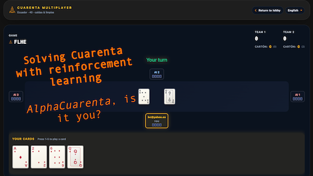

# Cuarenta AI engine

  

 

Here are some experiments I ran trying to build the ***ultimate Cuarenta AI engine*** 🤔. The best model I came up with is an Information Set Monte Carlo Tree Search + policy / value networks (AlphaGo style) engine. I also built ReBel and Searchless PPO versions, but they didn't do as good as the ISMCT + net model.

Read a **write-up** that includes an overall analysis of this project in my website [https://einecomadreja.xyz/factory/cuarenta-ai](https://einecomadreja.xyz/factory/cuarenta-ai).

Play **against the AI** in [https://cuarenta.einecomadreja.xyz](https://cuarenta.einecomadreja.xyz).
